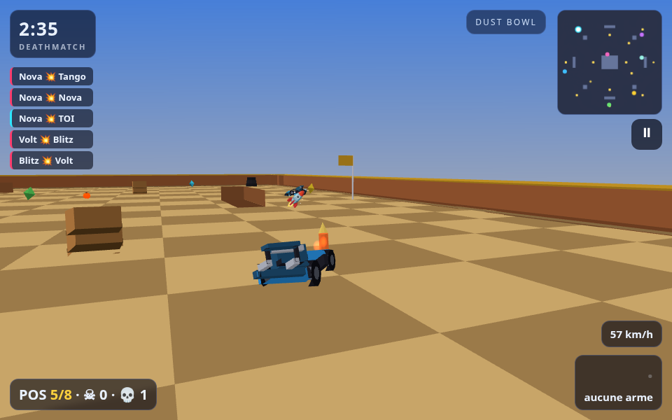
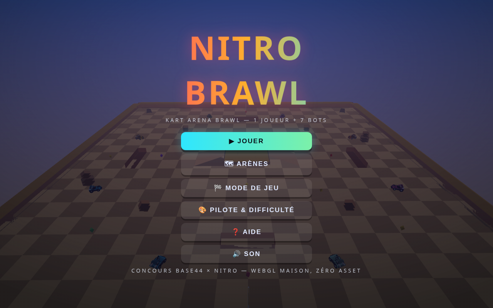
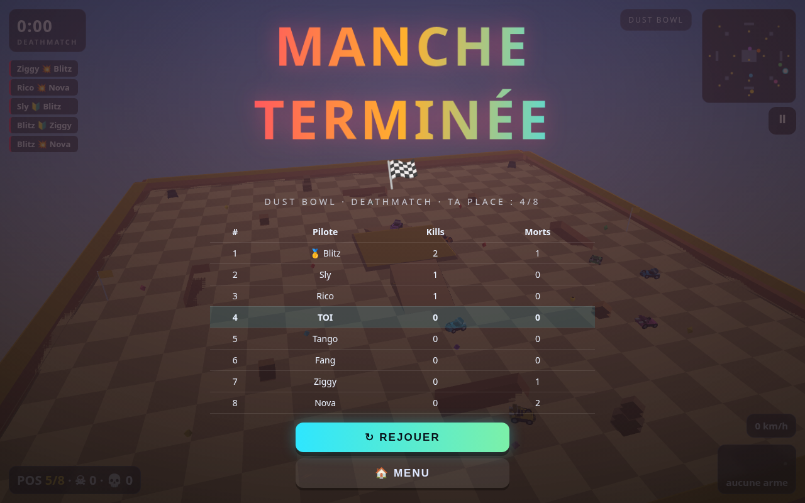

# NITRO BRAWL — arène de karts armés (1 fichier HTML)

**Jouer en ligne (GitHub Pages)** : https://baptistefaisy.github.io/nitro-brawl/
**Repo** : https://github.com/BaptisteFaisy/nitro-brawl






Jeu web complet, **zéro dépendance** : un seul `dist/index.html` à coller dans Base44.
Inspiré des batailles d'arène de karts (Smash Karts) : 1 joueur + 7 bots, power-ups,
élimination en un coup, respawn, 2 modes de jeu, 4 arènes, rendu **Three.js** (r149).
Géométrie et sons 100 % procéduraux : aucun asset externe.

## Livrable

```
dist/index.html     ← LE fichier à copier/coller (~160 Ko, tout inline : CSS + JS + moteur WebGL)
```

## Tester directement le jeu (sans se battre avec le GPU)

```bash
./jouer.sh                                  # ouvre le jeu dans Firefox (ou Chrome software) : tu joues
./jouer.sh "http://127.0.0.1:8745/index.offline.html?autopilot=1"   # le jeu se joue tout seul
node test/rapport.mjs                       # régénère test/rapport.html (4 captures + stats d'une manche)
firefox test/rapport.html                   # rapport visuel : captures, kills, tirs, triangles
node test/headless.mjs --frames=1800        # selftest + verdict OK/KO + test/last-report.json
node test/sim.mjs 7200 0                    # sim node sans navigateur (physique + IA), itération rapide
node test/sim.mjs 7200 0 elim               # idem en mode elimination
```

Params URL : `?autopilot=1` (IA sur le kart joueur) · `?selftest=N` (N frames + JSON) ·
`?freeze=1` (fige la scène après le selftest) · `?diag=1` (état de boot dans le titre de fenêtre) ·
`?map=dustbowl|neon|frost|foundry` · `?mode=elim`.

> Sur CE poste : Chrome n'a aucun WebGL (GPU inactif + repli logiciel bloqué) → Firefox,
> ou Chrome avec `--enable-unsafe-swiftshader`. `jouer.sh` s'en charge.

## Build & test (dev local, poste `pc`)

```bash
cd ~/Bureau/nitro-brawl
node build.mjs                 # assemble src/*.js → dist/index.html
node build.mjs --check         # vérifie syntaxe + taille des modules sans écrire
node test/headless.mjs --frames=300 --shot=test/shot.png   # selftest Chrome headless + capture
open dist/index.html           # ou : google-chrome dist/index.html
```

Le selftest headless simule N frames de match, puis affiche un JSON :
`ok`, `perFrame` (ms/frame), `fps`, `tris`, `sprites`, `moved` (nb de karts qui bougent),
`kills`, `particles`, `pickups`. Verdict KO si une erreur JS ou si moins de 6 karts bougent.

## Règles de jeu

| Mode | Règle |
|---|---|
| **Deathmatch** | 3 minutes, le plus d'éliminations gagne |
| **Elimination** | 1 vie chacun, pas de respawn, dernier kart debout gagne (~40 s/manche) |

8 karts (toi + 7 bots : Rookie / Pro / Legend). Un tir encaissé = élimination,
respawn 2,5 s avec 2 s d'invulnérabilité.

**Commandes clavier** : `ZQSD`/`WASD`/flèches = conduire · `Espace` ou clic = tirer ·
`Maj` = drift (charge un mini-boost au relâchement) · `E` ou clic droit = activer
(shield/boost/bélier) · `R` = respawn forcé · `Échap` = pause.
**Tactile** : joystick virtuel + boutons tirer / drift / bonus. **Manette** : gâchettes + A/B.

**Power-ups** : 🚀 roquette · 🎯 missile à tête chercheuse · 💣 grenade · 🧨 mine ·
🛢️ flaque d'huile · 🛡️ bouclier · ⚡ boost · 🔰 bélier.

## Structure du code (avant assemblage)

| Fichier | Rôle |
|---|---|
| `src/math.js` | vecteurs, matrices 4×4 column-major, lissages |
| `src/gl.js` | couche de rendu : adaptateur **Three.js** (API interne identique : meshes, batch, sprites billboards, ciel dégradé, fog, lumières) |
| `src/gl-legacy.js` | ancien moteur WebGL maison, conservé hors build (secours) |
| `src/mesh.js` | générateurs low-poly : boîtes, sphères, cylindres, cônes, tores, rampes, karts, caisses |
| `src/util.js` | horloge, formatage, stockage local, bus d'événements |
| `src/maps.js` | 4 arènes procédurales (Dust Bowl, Neon, Frost, Foundry) |
| `src/arena.js` | géométrie GPU + collision AABB + raycast + navigation + minimap |
| `src/kart.js` | physique arcade : adhérence, drift, rampes, sauts, collisions, respawn |
| `src/pickups.js` | power-ups : spawn sur pads, respawn, tirage pondéré |
| `src/weapons.js` | projectiles, pièges, explosions, dégâts de zone |
| `src/bots.js` | IA : machine à états, anticipation de tir, esquive, 4 personnalités |
| `src/fx.js` | particules (pool 900), traces de dérive, ondes de choc, screen shake |
| `src/audio.js` | WebAudio 100 % synthétique : moteur, dérive, tirs, explosions, musique procédurale |
| `src/hud.js` | menus DOM/CSS, HUD en jeu, minimap, killfeed, contrôles tactiles |
| `src/input.js` | clavier / souris / tactile / manette |
| `src/main.js` | boucle, caméra chase, règles de match, selftest |
| `CONTRACT.md` | contrat d'interfaces entre modules (source de vérité du dev) |

## Coller dans Base44

1. Base44 → ton app → éditeur de code / éditeur de texte.
2. Colle **l'intégralité** de `dist/index.html`.
3. Publie sur l'URL Base44 (obligatoire pour le concours : URL publique, gratuite, sans login).
4. Soumets sur https://nitropay.com/base44webgame/ avant le **3 décembre 2026, 23:59 UTC**.

> Astuce concours : le fichier fait ~250-350 Ko. Si l'éditeur Base44 refuse un collage
> aussi gros, découpe en 2 morceaux à la limite d'une ligne, ou demande à Base44
> d'ajouter le fichier comme « custom code » — le jeu est mono-fichier par conception,
> il n'a besoin d'aucun build côté serveur.

## Note concours

Aucun contenu protégé : pas de nom, logo, personnage, musique ou art issu d'un jeu
existant. Géométrie et sons 100 % générés par le code. Conforme au règlement
(« Games can't include copyrighted or trademarked material »).
